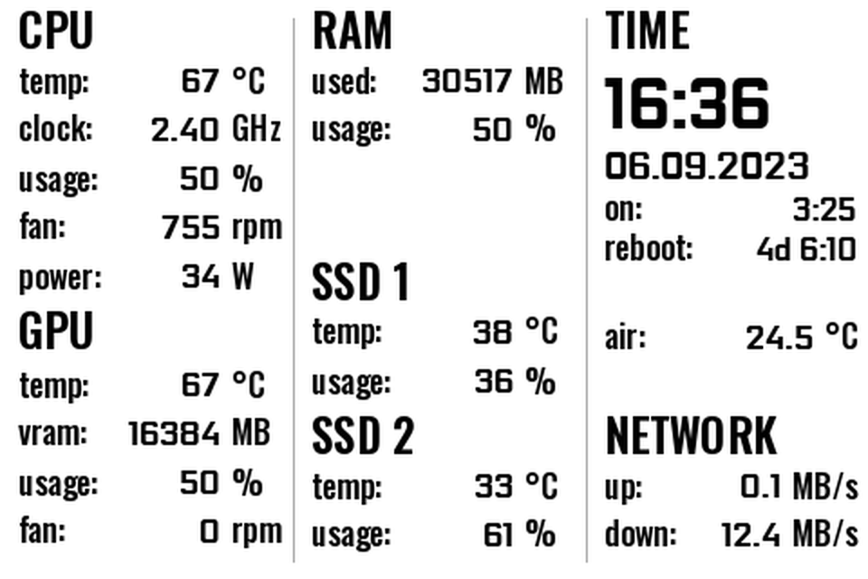
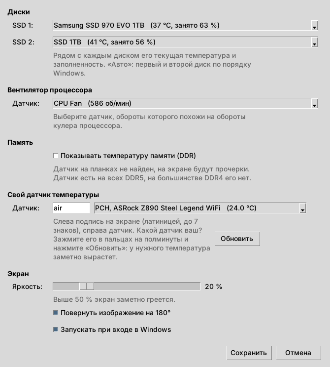
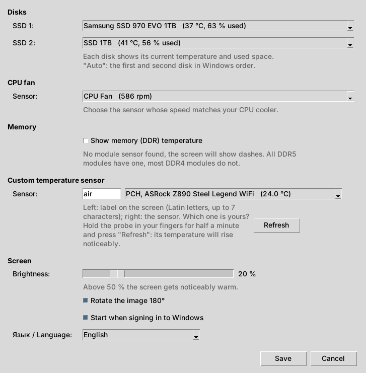

# TuringScreen Grid3: монитор системы для экрана Turing / TURZX 3.5"

Программа для маленького USB-экрана **Turing Smart Screen / TURZX 3.5"** (ревизия A, тот, что работает со штатной программой *UsbMonitor* / *35inchENG*). Заменяет штатную программу: одна папка с `TuringScreen.exe`, Python не нужен.

## Для каких экранов подходит

Для мини-экрана мониторинга, который ставят в системный блок или рядом с монитором: **TURZX 3.5"**, **Turing Smart Screen 3.5 дюйма**, **UsbPCMonitor 3.5"**. Обычно к такому экрану прилагается штатная программа **UsbMonitor** (архив **35inchENG**), а в Windows он определяется как USB-устройство с COM-портом (VID 1A86, PID 5722, серийный номер **USB35INCHIPSV2**). TuringScreen Grid3 заменяет UsbMonitor: показывает температуру процессора и видеокарты, загрузку, обороты вентиляторов, память, два SSD, сеть и время, работает без Python и настраивается в окне на русском или английском. Подходит тем, кто ищет программу для экрана температуры в корпусе ПК, замену UsbMonitor или бесплатную альтернативу панели датчиков AIDA64 для такого экрана.

## Что показывает

- **CPU:** температура, частота, загрузка, обороты вентилятора, мощность.
- **GPU:** температура, видеопамять, загрузка, обороты вентилятора.
- **RAM:** занято, загрузка; по желанию температура двух планок (если на планках есть датчик: все DDR5, немногие DDR4).
- **Два SSD:** температура и заполненность каждого (штатная программа умеет только один диск).
- **Время и дата**, время работы с включения (`on`) и с последней перезагрузки (`reboot`).
- **Свой датчик температуры** с вашей подписью, например воздух перед кулером (`air`).
- **Сеть:** отдача и приём, МБ/с.

## Установка

1. Установите драйвер датчиков **PawnIO** с [pawnio.eu](https://pawnio.eu). Без него не будет температуры и мощности CPU, вентиляторов и датчиков платы.
2. Скачайте архив из раздела **Releases** справа и распакуйте папку `TuringScreen` в постоянное место, например `C:\TuringScreen`.
3. Закройте штатную программу (UsbMonitor), если она запущена.
4. Запустите `TuringScreen.exe` и один раз разрешите права администратора. Программа настроит автозапуск, отключит автозапуск UsbMonitor, положит ярлык на рабочий стол и откроет окно настроек.

Если Windows покажет «Система Windows защитила ваш компьютер»: «Подробнее» → «Выполнить в любом случае». Exe не подписан цифровой подписью, поэтому так бывает; по той же причине некоторые антивирусы могут ошибочно ругаться на файлы, собранные PyInstaller. Исходный код полностью открыт, exe можно собрать самому (см. ниже).

## Настройки

Щелчок по значку программы в трее открывает окно настроек:

- **SSD 1 и SSD 2:** выбор дисков, рядом видны их температура и заполненность.
- **Вентилятор процессора:** датчик оборотов кулера CPU.
- **Память:** показывать ли температуру планок.
- **Свой датчик температуры:** подпись (латиницей, до 7 знаков) и датчик платы или контроллера. Чтобы найти свой, зажмите датчик пальцами на полминуты и нажмите «Обновить».
- **Яркость, поворот на 180°, автозапуск.**
- **Язык / Language:** интерфейс на русском или английском; по умолчанию как в Windows.

Выход и перезапуск: значок в трее, правая кнопка. Журналы `launcher.log` и `log.log` лежат в папке программы.

Удаление: `TuringScreen.exe --uninstall` (Win+R, полный путь к exe), затем удалить папку.

## Если экран не найден

Программа ждёт экран до 2 минут. Если не дождалась, выньте USB-кабель экрана на полминуты и запустите ярлык снова. Экраны ревизии A иногда «теряются» после перезапуска программы; это особенность самого экрана.

## Сборка из исходников

Нужны Windows, Python 3.11 и git. Запустите `build.bat`: он скачает оригинальную программу (версия `2b33ab4`), положит поверх неё файлы из папки `src` и соберёт `upstream\dist\TuringScreen\TuringScreen.exe`.

Тему (`src/res/themes/Grid3_2SSD`) создаёт скрипт `tools/gen_theme.py`; координаты строк и подписи меняются в нём.

## Как сделано

Программа создана с помощью **[Claude](https://claude.ai)**, ИИ-ассистента компании Anthropic. Код, тему и сборку написал Claude по запросам автора репозитория; автор ставил задачи, согласовывал макеты экрана и проверял работу на реальном железе.

## Благодарности и лицензия

Основано на [turing-smart-screen-python](https://github.com/mathoudebine/turing-smart-screen-python) (Matthieu Houdebine и соавторы). Датчики читаются через [LibreHardwareMonitor](https://github.com/LibreHardwareMonitor/LibreHardwareMonitor). Подробности о сторонних компонентах: [THIRD_PARTY.md](THIRD_PARTY.md).

Лицензия: **GNU GPL 3.0**, как у оригинальной программы (файл [LICENSE](LICENSE)).

Проект сделан для себя и выложен как есть, без гарантий и обязательной поддержки.

---

## English

**Which screens:** the small USB system-monitor screens sold as **TURZX 3.5"**, **Turing Smart Screen 3.5 inch** or **UsbPCMonitor 3.5"**, normally shipped with the *UsbMonitor* / *35inchENG* software and seen by Windows as a USB serial (COM port) device with VID 1A86, PID 5722 and serial number **USB35INCHIPSV2**. If you are looking for a UsbMonitor replacement, a CPU/GPU temperature display for your PC case, or a free alternative to an AIDA64 sensor panel for this screen, this is it.

**TuringScreen Grid3** is a standalone Windows replacement for the stock *UsbMonitor* software of the **Turing Smart Screen / TURZX 3.5" (revision A)**. It is built on [turing-smart-screen-python](https://github.com/mathoudebine/turing-smart-screen-python) and packaged with PyInstaller: one folder, no Python required.

The interface (settings window, tray menu, messages) is available in **English and Russian**; by default it follows the Windows display language and can be switched in the settings.

Features: CPU/GPU/RAM stats, **two SSDs** (temperature and used space), optional RAM module temperatures, uptime since power-on and since last restart, one user-defined temperature sensor with a custom label, network speed, and a settings window (tray icon click) to pick disks, fan and sensors. Autostart is done via Task Scheduler, so there is no UAC prompt on every start.

This program was created with the help of **[Claude](https://claude.ai)**, an AI assistant by Anthropic: the code, theme and build were written by Claude at the request of the repository owner, who defined the tasks, approved the screen layouts and tested it on real hardware.

Install: install the [PawnIO](https://pawnio.eu) driver, download the release archive, unpack it to a permanent folder, run `TuringScreen.exe` once and allow admin rights. Step-by-step instructions are in `INSTRUCTIONS_EN.txt` inside the archive. Build from source: run `build.bat` (Python 3.11 + git). License: GPL-3.0, same as the base project.
